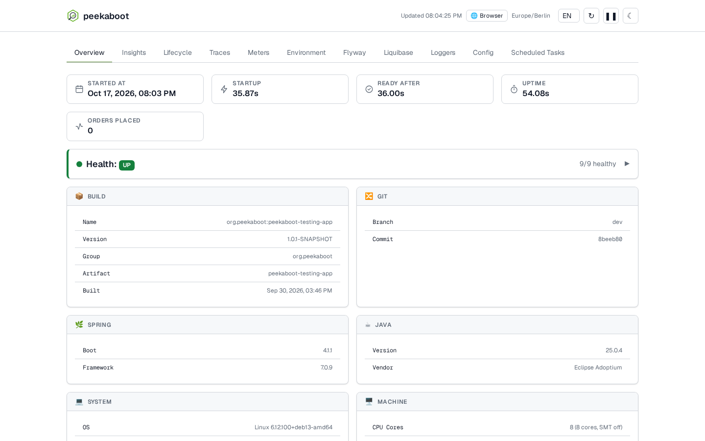

<p align="center">
  <picture>
    <source media="(prefers-color-scheme: dark)" srcset="peekaboot-frontend/src/main/resources/META-INF/peekaboot/ui/assets/logo-mark-dark.png">
    
  </picture>
</p>

# Peekaboot

> [!WARNING]
> Peekaboot is beta software and may expose security-relevant settings. Use it at your own risk.

Peekaboot lets you peek inside your Spring Boot application while it runs. Health, config,
migrations, logs, schedules, metrics and traces in one dashboard, with no external infrastructure.

## Why Peekaboot?

Peek, because it lets you look inside a running application. Boot, because that's where it
lives. And peek-a-boo, because that's how it behaves. Add one dependency and your app's
internals show up on a local run. Deploy the same jar and Peekaboot stays off.

## Quick start

```xml
<dependency>
    <groupId>org.peekaboot</groupId>
    <artifactId>peekaboot-spring-boot-starter</artifactId>
    <version>1.1.0</version>
</dependency>
```

Run your app the way you already do. Peekaboot detects a local run, turns itself on and
serves the dashboard at `http://localhost:8080/peekaboot/`. The Gradle coordinate is in the
[quick start](https://www.peekaboot.org/docs/quick-start/); what counts as a local run and
how to override the detection are in
[Configuration](https://www.peekaboot.org/docs/configuration/#local-run).



## What you get

- A dev toolbar docked to every HTML page your app renders, with request status, duration,
  the span, query and log counts with query time and error and warning counts, and a link to
  the full trace.
- A dashboard for health, environment, config, Flyway, Liquibase (from 1.1.0), loggers,
  scheduled tasks and metrics, read in-process with nothing exposed under `/actuator/**`.
- In-memory request tracing via Micrometer and OpenTelemetry, with no collector to run.
- Every SQL statement a request runs is timed, listed and highlighted, and shown formatted
  with its bind parameters on request. From 1.1.0 each one is labelled with the DataSource it
  ran on. The starter brings the JDBC instrumentation, so there is none to wire up yourself.
- Charts that mark every application start and stop, with metric history surviving a
  restart.
- An error page on a local run, in place of the whitelabel page, carrying the exception,
  the stack trace and the toolbar.
- Zero configuration, on for a local run, off for a deployment or a test.

## Documentation

Full docs live at [www.peekaboot.org](https://www.peekaboot.org).

- [Quick start](https://www.peekaboot.org/docs/quick-start/)
- [Do I want this in production?](https://www.peekaboot.org/docs/in-production/)
- [Dev toolbar](https://www.peekaboot.org/docs/dev-toolbar/)
- [Error page](https://www.peekaboot.org/docs/error-page/)
- [The dashboard](https://www.peekaboot.org/docs/dashboard/)
- [Traces](https://www.peekaboot.org/docs/traces/)
- [Insights](https://www.peekaboot.org/docs/insights/)
- [Configuration](https://www.peekaboot.org/docs/configuration/)
- [HTTP API](https://www.peekaboot.org/docs/api/)
- [Security](https://www.peekaboot.org/docs/security/)
- [Troubleshooting](https://www.peekaboot.org/docs/troubleshooting/)
- [Releases](https://www.peekaboot.org/releases/)
- [Acknowledgements](https://www.peekaboot.org/docs/acknowledgements/)
- [Contributing](https://www.peekaboot.org/docs/contributing/)

## Working on Peekaboot

```
peekaboot/
├── peekaboot-test-support/               # Shared test helpers (never published)
├── peekaboot-backend/                    # Core logic and APIs
├── peekaboot-frontend/                   # Static web resources
├── peekaboot-spring-boot-autoconfigure/  # Auto-configuration
├── peekaboot-spring-boot-starter/        # Dependency aggregator
├── peekaboot-testing-app/                # Sample app + UI tests
└── peekaboot-coverage/                   # JaCoCo aggregate report + coverage floor
```

```bash
./mvnw clean verify                                # every test and every gate
./mvnw test                                        # unit tests only
./mvnw -pl peekaboot-testing-app spring-boot:run   # the sample app on :8093
```

[`BUILD.md`](BUILD.md#commands) has the rest: every command, what each gate checks, what the
sample app needs, and the parallel Gradle build.

Further reading:

- [`BUILD.md`](BUILD.md) for the reactor, the gates, CI and the release pipeline.
- [`docs/ARCHITECTURE.md`](docs/ARCHITECTURE.md) for the module structure, the
  auto-configuration wiring, tracing and the data models.
- [`docs/TESTING.md`](docs/TESTING.md) for test structure, fixtures and the
  pristine-output rule.
- [`docs/GLOSSARY.md`](docs/GLOSSARY.md) for domain terms.
- [`peekaboot-frontend/README.md`](peekaboot-frontend/README.md) for the shared frontend
  layers, the design tokens and their pairing rules, and how to add a dashboard tab.
- [`peekaboot-testing-app/README.md`](peekaboot-testing-app/README.md) for the sample
  app, its UI suite and the screenshot-capture command.

## Requirements

- Java 25 or newer, the current LTS. The build compiles with `release 25` and has no
  toolchain fallback, Peekaboot's collectors run on virtual threads, and nothing below 25 is
  built or tested.
- Spring Boot 4.1.
- A servlet web application.

## License

Apache License 2.0. Bundled third-party components and their licences are listed in
[`NOTICE`](NOTICE).
